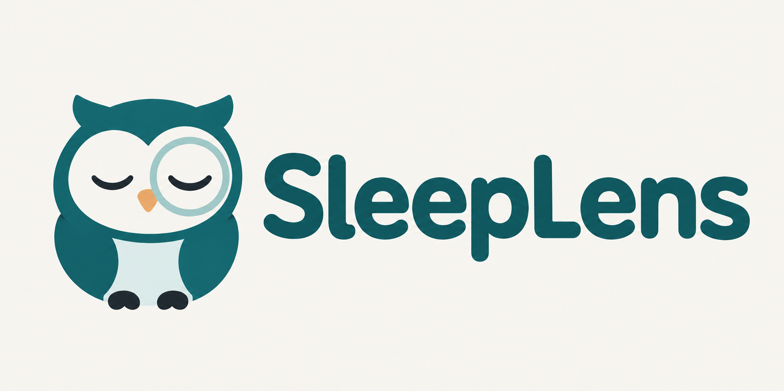
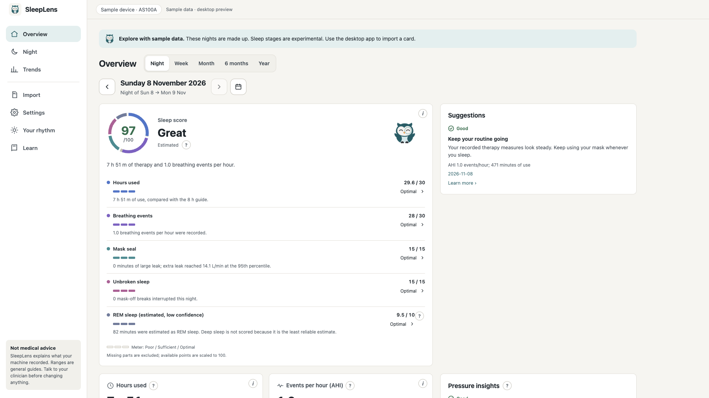

<p align="center">
  
</p>

# SleepLens

Understand your CPAP nights, with your data stored on your computer.

SleepLens is a free, open-source desktop app for people who want to make sense of their CPAP therapy. Import an Aeonmed AS100 SD card, check your nightly usage and mask seal, and explore the pressure and breathing events behind the summary. Plain-language explanations sit next to the numbers.

**Early macOS build · Aeonmed AS100A card support · Local storage · MIT licensed**

[Explore the demo](https://goodtreefaith.github.io/sleeplens/demo/) · [Build for macOS](#build-for-macos) · [Contribute](CONTRIBUTING.md) · [Request a feature](https://github.com/goodtreefaith/sleeplens/issues/new/choose)

> SleepLens is in early development. There is no published installer yet. The browser demo uses the current app interface with made-up data; it does not import your SD card. Build the desktop app to read a supported card.

## See your nights more clearly

| Start with a question | Explore it in SleepLens |
| --- | --- |
| How did last night go? | See hours of therapy, breathing events per hour, mask leak and pressure, with explanations of the terms. |
| When did something change? | Inspect a night's pressure, flow and leak charts alongside recorded events and mask-on sessions. |
| How does this compare with other nights? | Review usage history and trends over a week, month, six months or year. |
| What does this number mean? | Open inline help or the built-in glossary without leaving the app. |

The app also includes an experimental sleep score and breathing-based sleep stage estimates. Early sleep-lab comparisons have not established reliable four-stage estimates. Read the [measured results and limitations](docs/SLEEP_STAGE_METHOD.md) before interpreting them. CPAP usage time is not the same as time asleep.

## Your rhythm, if you want to explore it

The optional Your rhythm screen asks about the part of the day you prefer, your usual free-day sleep window and a focus window you choose. Its labels reflect your answers. This original short reflection is not a validated chronotype test, and SleepLens does not measure your body clock or predict a productivity peak. Variable schedules and alarm constraints appear with the result.

Answers stay on your computer in the desktop app. In the demo, they stay in page memory and disappear on reload. You can skip, edit or clear them, and they never change therapy measurements or your sleep score.

The score card's owl has six decorative expressions, plus a curious state when the score is unavailable. The artwork does not change score calculations or their meaning.

## Take a look



*The desktop interface running in browser sample mode. All values are synthetic.*

Try the [interactive app demo](https://goodtreefaith.github.io/sleeplens/demo/) without a card or account. To preview the current React interface locally:

```bash
git clone https://github.com/goodtreefaith/sleeplens.git
cd sleeplens/app
npm ci
npm run dev
```

Open the localhost URL printed in the terminal and choose **Try with sample data**. Browser mode uses mock data and does not read your real card. You need Node.js 20 or newer for this preview.

The [public demo](demo/) builds from the same React screens and mock API as the desktop interface. To refresh it after an interface change, run `npm --prefix app run build:demo` from the repository root. See [demo/README.md](demo/README.md) for local serving instructions.

## Your therapy data stays on your device

The desktop app reads the card and stores imported summaries and chart data in a local SQLite database. You can put the card back in your machine after importing, then review the imported nights without it.

- No account, cloud upload or analytics in the desktop app.
- The desktop web view loads bundled assets, with a Content Security Policy that blocks remote connections.
- Imports read your card without changing its files. Re-imports skip unchanged night files.
- Settings shows the data location and lets you delete imported data.

On macOS, the database lives in `~/Library/Application Support/com.goodtreefaith.sleeplens/`. It is a local database, not an encrypted vault; protect your computer and backups. The hosted design demo is a separate website served by GitHub Pages.

## Supported machines

| Machine family | Current status |
| --- | --- |
| Aeonmed AS100 series, identified as `AS2X` | Implemented first target, with AS100A findings documented in the format notes. Some event codes and leak behavior still need validation. |
| ResMed AirSense 10 / 11 | Planned. Not supported by the current importer. |
| Philips DreamStation | Future work. Parser contributions welcome. |

See the [format notes](docs/FORMAT_NOTES.md) for known fields and uncertainties. Some nights may lack AHI or event summaries when the machine's backup log no longer retains them. SleepLens marks missing values rather than treating them as zero.

For another machine, [request support](https://github.com/goodtreefaith/sleeplens/issues/new/choose) with its brand, model and a redacted folder layout. Keep card files, serial numbers and personal therapy records out of public issues.

## Build for macOS

Install Node.js 20+, a stable Rust toolchain and the [Tauri macOS prerequisites](https://v2.tauri.app/start/prerequisites/#macos). Then, from a clone of this repository:

```bash
cargo install tauri-cli --version "^2" --locked
cd app
npm ci
cargo tauri dev
```

To build an application bundle, run this from `app/`:

```bash
cargo tauri build --bundles app
```

The output is `target/release/bundle/macos/SleepLens.app` at the repository root. Start with **Try with sample data** to explore before importing a card. Windows support is planned; there is no tested Windows release yet.

## What's next

- Printable summaries for appointments.
- Signed and notarized macOS distribution.
- Windows packaging and device testing.
- ResMed support, followed by more machine families.

These are planned work, not download promises. The [implementation plan](docs/IMPLEMENTATION_PLAN.md) has the technical detail.

## Help build SleepLens

Contributions can improve explanations, accessibility, test coverage and machine support. Start with the [contributor guide](CONTRIBUTING.md) for setup, checks and the rules for synthetic fixtures.

| Resource | What you'll find |
| --- | --- |
| [App contract](docs/APP_CONTRACT.md) | Data types and commands shared by Rust and React |
| [Format notes](docs/FORMAT_NOTES.md) | Aeonmed card layout, confirmed fields and open questions |
| [Implementation plan](docs/IMPLEMENTATION_PLAN.md) | Architecture and planned work |
| [Issues](https://github.com/goodtreefaith/sleeplens/issues) | Bug reports and requests |

## Health and safety

SleepLens helps you inspect data your machine recorded. It does not diagnose sleep disorders or replace a clinician. Scores, estimates and general guides must not drive changes to prescribed therapy. Discuss concerns and machine settings with your sleep clinic.

## License

SleepLens is available under the [MIT license](LICENSE).
